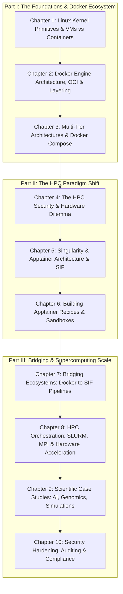

# CONTAINERS IN SCIENCE & HIGH-PERFORMANCE COMPUTING
## Mastering Docker, Apptainer, and Singularity for Enterprise and Supercomputing Workloads

**Author: Sudheer K. Mohammed**

*First Edition — 2026*

---

## Dedication

> *To the scientists, engineers, researchers, and systems administrators who bridge theoretical algorithms with physical supercomputers — turning silicon and code into discoveries that advance humanity.*

---

## About the Author

**Sudheer K. Mohammed** is a seasoned systems architect, High-Performance Computing (HPC) specialist, and distributed systems practitioner. With deep expertise spanning cloud-native containerized architectures, multi-tenant supercomputing clusters, low-latency interconnects, and scalable GPU workflows, Sudheer has engineered container orchestration strategies for enterprise deployments, academic research facilities, and national supercomputing centers. His passion lies in solving the fundamental friction points between enterprise developer agility and the unforgiving performance, security, and scalability constraints of massive-scale scientific computing.

---

## Foreword

In the early 2010s, Docker revolutionized software development. By marrying Linux kernel cgroups and namespaces with the intuitive Union File System layering model, Docker solved the infamous *"it works on my machine"* problem for cloud applications and enterprise microservices. Developers could package an application, its system libraries, its language runtime, and its dependencies into a self-contained, reproducible artifact that ran identically on a local developer laptop, a staging server, or an elastically scaling Kubernetes cluster.

However, when computational scientists and data engineers attempted to transport Docker directly into supercomputing centers, university clusters, and national laboratories, they encountered an unyielding architectural wall: **The High-Performance Computing (HPC) Dilemma**.

HPC environments operate under assumptions diametrically opposed to enterprise cloud platforms:
1. **Multi-Tenancy & Security:** Supercomputer nodes are shared among hundreds of concurrent, untrusted users. Running a root-owned background daemon (`dockerd`) with user-facing execution privileges constitutes an unacceptable privilege-escalation vulnerability on shared network-attached filesystems (NFS, Lustre, GPFS).
2. **POSIX Identity:** In scientific compute clusters, file access permissions are strictly regulated by Unix User IDs (UID) and Group IDs (GID). A container must not run as root; it must execute with the exact identity of the invoking user.
3. **Bare-Metal Hardware Coupling:** Supercomputers derive their throughput from hardware integration: InfiniBand Non-Volatile Memory express (NVMe) over Fabrics, host MPI libraries optimized for cluster topologies, and direct high-throughput GPU interconnects (NVLink, NVSwitch, ROCm). Virtualized software network bridges and layered filesystem penalties cannot be tolerated.

From this friction arose **Singularity** (and its modern Linux Foundation successor, **Apptainer**). Designed from first principles for multi-user compute clusters, Apptainer re-imagined the container not as a lightweight virtual machine with an emulated network and a background daemon, but as an **encapsulated executable**—a single-file image (`.sif`) that mounts without root privileges, maps the host user directly into the process tree, and talks natively to host hardware, InfiniBand stacks, and distributed resource managers like SLURM.

This book is the definitive, unified guide for engineers, researchers, and administrators who must master both worlds. Whether you are building containerized microservices in Docker, translating those images into Singularity/Apptainer for execution across thousands of compute nodes, or orchestrating distributed deep learning models across clusters of NVIDIA H100 GPUs with SLURM and MPI, this volume equips you with deep architectural knowledge and production-ready code.

---

## Executive Summary & Architecture Map

Below is the conceptual journey through the ten chapters of this book:

---

## Table of Contents

- **Front Matter**
  - Dedication
  - About the Author
  - Foreword
- **[Chapter 1: The Containerization Revolution — From Linux Kernel Primitives to Modern Runtimes](./01_foundations_of_containerization.md)**
- **[Chapter 2: Docker Deep Dive — Engine Architecture, Image Layering, and Container Lifecycles](./02_docker_deep_dive.md)**
- **[Chapter 3: Composing Multi-Tier Architectures — Networking, Storage Volumes, and Docker Compose](./03_orchestrating_microservices_with_docker_compose.md)**
- **[Chapter 4: The High-Performance Computing (HPC) Dilemma — Why Enterprise Docker Fails on Supercomputers](./04_the_hpc_security_and_architectural_dilemma.md)**
- **[Chapter 5: The Singularity and Apptainer Paradigm — Origin, Architectural Philosophy, and the SIF Format](./05_singularity_and_apptainer_architecture.md)**
- **[Chapter 6: Building Apptainer Containers — Definition Files, Sandboxes, and Multi-Stage Builds](./06_authoring_apptainer_recipes_and_building_sifs.md)**
- **[Chapter 7: Bridging Ecosystems — Converting Docker Images to Apptainer SIF and CI/CD Automation](./07_bridging_ecosystems_docker_to_apptainer.md)**
- **[Chapter 8: HPC Workload Orchestration — SLURM Integration, Multi-Node MPI, and Native GPU Acceleration](./08_hpc_orchestration_slurm_mpi_and_gpus.md)**
- **[Chapter 9: Production Case Studies — Distributed AI Training, Bioinformatics Workflows, and Scientific Simulations](./09_scientific_and_enterprise_case_studies.md)**
- **[Chapter 10: Security Audits, Compliance, Best Practices, and Future Frontiers](./10_security_compliance_and_production_hardening.md)**
- **[Appendices & Cheatsheets](./11_appendices_and_cheatsheets.md)**
  - Appendix A: Cross-Engine Command Matrix (Docker vs Apptainer vs Singularity)
  - Appendix B: Production Troubleshooting Guide & Error Dictionary
  - Appendix C: Standard SLURM Job Submission Templates
