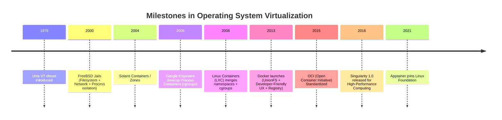

# Chapter 1: The Containerization Revolution
## From Linux Kernel Primitives to Modern Runtimes

*Author: Sudheer K. Mohammed*

---


### Chapter Overview
Before the advent of modern container platforms like Docker, Apptainer, and Singularity, isolating software execution required either provisioning dedicated bare-metal servers or deploying heavy Hypervisor-based Virtual Machines (VMs). To truly master container engines and diagnose low-level runtime anomalies in enterprise clouds or High-Performance Computing (HPC) clusters, one must first dismantle the illusion that a container is a "mini virtual machine." 

A container is not a machine. A container is simply an ordinary Linux host process confined by a set of kernel isolation barriers and resource fences.

In this chapter, we dissect:
1. The historical evolution from UNIX `chroot` to modern Linux Containers (LXC).
2. The fundamental kernel primitives: Namespaces, Control Groups (cgroups v1 & v2), Capabilities, and Seccomp.
3. The architectural differences between Hypervisor Virtualization and Operating System-Level Virtualization.
4. A hands-on tutorial: Constructing a working container from scratch using pure Linux command-line utilities without installing Docker or Apptainer.

---

## 1.1 The Evolutionary Path of Process Isolation

The quest for software isolation stems from two requirements: **security** (preventing an errant or malicious process from compromising adjacent workloads) and **reproducibility** (ensuring consistent libraries, paths, and dependencies across environments).



### 1. The Genesis: `chroot` (1979)
Introduced during the development of Version 7 Unix, the `chroot` (change root) system call allowed a process and its child subprocesses to see a specified directory as the new root (`/`) of the filesystem hierarchy. While `chroot` successfully created isolated filesystem views—known colloquially as a *chroot jail*—it provided zero isolation for process tables, network sockets, IPC mechanisms, or user credentials. A root user inside a `chroot` jail could easily escape to the host root by manipulating file descriptors (`fchdir`).

### 2. FreeBSD Jails (2000) and Solaris Zones (2004)
FreeBSD Jails expanded upon `chroot` by virtualizing the network subsystem (assigning dedicated IP addresses) and restricting the superuser's ability to manipulate kernel state. Solaris Zones subsequently introduced fine-grained resource controls and dedicated virtual environments within a single operating system instance.

### 3. Linux Control Groups (2006–2008)
In 2006, Google engineers Rohit Seth and Paul Menage began work on *Process Containers*, which was later renamed **Control Groups (cgroups)** and merged into the mainline Linux kernel 2.6.24 in 2008. Combined with Linux Namespaces, cgroups gave Linux the foundational machinery necessary to sandbox workloads natively.

### 4. LXC (2008) and the Birth of Docker (2013)
LXC (LinuX Containers) combined cgroups and namespaces into a coherent user-space toolset. However, LXC remained difficult to manage and configure. In 2013, Solomon Hykes and the team at dotCloud open-sourced **Docker**. Docker wrapped these low-level kernel primitives with an elegant, portable image-layering mechanism (UnionFS / AUFS) and a centralized public image repository (Docker Hub).

---

## 1.2 The Anatomy of the Linux Kernel: Namespaces

Linux **namespaces** partition kernel resources such that one set of processes sees one set of resources, while another set of processes sees a completely disjoint set.

As of modern Linux kernels (6.x+), there are eight primary namespaces:

| Namespace | Kernel Flag | Isolates | Effect on Process |
| :--- | :--- | :--- | :--- |
| **Mount (mnt)** | `CLONE_NEWNS` | Filesystem mount points | Container has its own isolated `/`, `/tmp`, `/var` without affecting the host filesystem |
| **Process ID (pid)** | `CLONE_NEWPID` | Process IDs | Container process becomes PID 1 inside, while having an ordinary PID on the host |
| **Network (net)** | `CLONE_NEWNET` | Network devices, IP routing tables, firewall rules, ports | Container has its own `eth0`, `lo`, loopback, routing table, and private port range |
| **Inter-Process Comm (ipc)** | `CLONE_NEWIPC` | System V IPC, POSIX message queues | Prevents shared memory segments (`shmget`) across containers |
| **UTS (Hostname)** | `CLONE_NEWUTS` | Hostname and NIS domain name | Container can set its own hostname (e.g., `hostname compute-worker-01`) |
| **User (user)** | `CLONE_NEWUSER` | UID and GID mappings | Root inside container (`UID 0`) maps to an unprivileged UID on the host (`UID 10001`) |
| **Control Group (cgroup)** | `CLONE_NEWCGROUP` | Root directory of cgroup hierarchy | Prevents container from inspecting host cgroup tree |
| **Time (time)** | `CLONE_NEWTIME` | Boot and monotonic clocks | Allows container to adjust internal offsets for testing time-sensitive applications |

### Inspecting Namespaces in User Space

Every process running on a Linux system exposes its active namespaces via the `/proc` virtual filesystem:

```bash
# Inspect the active namespaces of the current shell
$ ls -l /proc/$$/ns/
total 0
lrwxrwxrwx 1 user user 0 Oct 25 10:00 cgroup -> 'cgroup:[4026531835]'
lrwxrwxrwx 1 user user 0 Oct 25 10:00 ipc -> 'ipc:[4026531839]'
lrwxrwxrwx 1 user user 0 Oct 25 10:00 mnt -> 'mnt:[4026531840]'
lrwxrwxrwx 1 user user 0 Oct 25 10:00 net -> 'net:[4026531992]'
lrwxrwxrwx 1 user user 0 Oct 25 10:00 pid -> 'pid:[4026531836]'
lrwxrwxrwx 1 user user 0 Oct 25 10:00 pid_for_children -> 'pid:[4026531836]'
lrwxrwxrwx 1 user user 0 Oct 25 10:00 time -> 'time:[4026531834]'
lrwxrwxrwx 1 user user 0 Oct 25 10:00 time_for_children -> 'time:[4026531834]'
lrwxrwxrwx 1 user user 0 Oct 25 10:00 user -> 'user:[4026531837]'
lrwxrwxrwx 1 user user 0 Oct 25 10:00 uts -> 'uts:[4026531838]'
```

Each namespace is identified by an inode number (e.g., `mnt:[4026531840]`). If two processes reference the same inode string for a given namespace, they share that resource boundary.

---

## 1.3 Control Groups (cgroups): Resource Fencing

While namespaces control **what a process can see**, Control Groups (cgroups) govern **how much resource a process can consume**. Without cgroups, a single process inside a container could trigger an Out-Of-Memory (OOM) storm or starve all CPU cores on an HPC node.

### cgroups v1 vs. cgroups v2
In **cgroups v1**, each resource controller (memory, cpu, blkio, pids) maintained an independent, orthogonal directory hierarchy under `/sys/fs/cgroup/`. This led to race conditions, conflicting resource limits, and deadlocks.

In **cgroups v2** (unified hierarchy, default in modern distributions like RHEL 9, Ubuntu 22.04+, and Debian 12), the kernel implements a single, unified process tree. Every process belongs to exactly one cgroup node in `/sys/fs/cgroup/`.

```
/sys/fs/cgroup/
├── cgroup.controllers      # List of enabled controllers (cpu, memory, io, pids)
├── cgroup.procs            # PIDs belonging to this slice
├── memory.max              # Hard memory limit (e.g., 4G)
├── memory.current          # Current memory consumption
├── cpu.max                 # CPU bandwidth quota: quota period (e.g., 200000 100000 = 2 cores)
└── pids.max                # Maximum process count to prevent fork bombs
```

When an application exceeds `memory.max`, the Linux kernel triggers the in-kernel OOM killer, which sends a `SIGKILL` (exit code 137) specifically to processes within that cgroup sub-tree without terminating the host operating system.

---

## 1.4 Linux Capabilities and Seccomp

Running as `root` (UID 0) on Linux historically granted omnipotent authority to alter system clocks, load kernel modules, manipulate network routing tables, and override file permissions. Modern container engines break this all-or-nothing root model using:

### 1. POSIX Capabilities (`capabilities(7)`)
Linux divides traditional superuser privileges into distinct units called **Capabilities**. For example:
- `CAP_CHOWN`: Make arbitrary changes to file UIDs and GIDs.
- `CAP_NET_BIND_SERVICE`: Bind a socket to privileged ports (< 1024).
- `CAP_SYS_ADMIN`: Overly broad "super-root" capability (allows mounting filesystems, configuring namespaces).
- `CAP_SYS_RAWIO`: Perform raw I/O operations directly to physical memory and PCI devices.

By default, Docker and Apptainer strip dangerous capabilities (such as `CAP_SYS_ADMIN`, `CAP_SYS_RAWIO`, and `CAP_SYS_MODULE`), ensuring that even if a container process runs with UID 0, it cannot compromise the underlying kernel.

### 2. Seccomp (Secure Computing Mode)
Seccomp acts as a firewall for Linux system calls. When a container runtime executes an image, it attaches a Berkley Packet Filter (BPF) seccomp profile to the process. If an application attempts to invoke an unauthorized system call (such as `reboot`, `sys_ptrace`, or `mount`), the kernel immediately intercepts the call and terminates the process with `SIGSYS` or returns `EPERM`.

---

## 1.5 Virtual Machines vs. Containers: Architectural Comparison

Understanding the structural differences between hypervisor-managed virtual machines and container runtimes is paramount for both enterprise architects and scientific software developers.

```
+------------------------------------+      +------------------------------------+
|         VIRTUAL MACHINE            |      |             CONTAINER              |
+------------------------------------+      +------------------------------------+
|  [App A]   |  [App B]   |  [App C] |      |  [App A]   |  [App B]   |  [App C] |
|  User Libs |  User Libs |  User Libs|      |  User Libs |  User Libs |  User Libs|
+------------+------------+----------+      +------------+------------+----------+
|  GUEST OS  |  GUEST OS  | GUEST OS |      | Namespaces | Namespaces |Namespaces|
|  Kernel    |  Kernel    | Kernel   |      | & cgroups  | & cgroups  |& cgroups |
+------------+------------+----------+      +------------------------------------+
|   HYPERVISOR (KVM / VMware / Xen)  |      |         HOST LINUX KERNEL          |
+------------------------------------+      +------------------------------------+
|       PHYSICAL HOST HARDWARE       |      |       PHYSICAL HOST HARDWARE       |
+------------------------------------+      +------------------------------------+
```

### Deep Architectural Differences

| Attribute | Hypervisor Virtual Machine (VM) | Container (Docker / Apptainer) |
| :--- | :--- | :--- |
| **Virtualization Layer** | Hardware Abstraction (vCPU, vRAM, virtual disk, emulated PCI devices) | Operating System Abstraction (Namespaces, cgroups) |
| **Kernel Identity** | Each VM boots its own independent guest kernel | All containers share the single underlying Host Linux kernel |
| **Startup Latency** | Tens of seconds to minutes (BIOS, kernel init, systemd) | Milliseconds (executes as a standard host fork/exec) |
| **Memory Footprint** | Fixed allocation; memory ballooning required; duplicative OS cache | Dynamic allocation; zero overhead beyond actual binary consumption |
| **I/O Performance** | Virtualized block and network drivers (virtio); latency overhead | Bare-metal performance; native syscalls to host hardware |
| **HPC Interconnects** | Difficult pass-through of InfiniBand, RoCE, or NVLink | Direct, native access to Mellanox OFED and NVIDIA GPU drivers |
| **Portability Boundary**| Any OS supported by hypervisor (Linux, Windows, BSD) | Linux binary compatible with host kernel architecture (x86_64, aarch64) |

---

## 1.6 Hands-On: Building a Container from Scratch Using Pure Linux

To demonstrate that a container is nothing more than ordinary Linux system primitives, let us create a functional, isolated container environment using only standard GNU/Linux tools: `unshare`, `cgroups`, and `chroot`.

### Step 1: Prepare a Minimal Root Filesystem (RootFS)
We download and extract an Alpine Linux minirootfs into a local directory:

```bash
# Create a workspace directory
mkdir -p /tmp/mini_container/rootfs
cd /tmp/mini_container

# Download Alpine Linux minimal root filesystem (x86_64)
curl -sSL -o alpine.tar.gz \
  https://dl-cdn.alpinelinux.org/alpine/v3.19/releases/x86_64/alpine-minirootfs-3.19.1-x86_64.tar.gz

# Extract into rootfs
tar -xzf alpine.tar.gz -C rootfs/
```

### Step 2: Establish a cgroups v2 Memory and PID Fence
Next, we create a dedicated cgroup slice to ensure our container cannot exceed 128 MB of RAM or spawn more than 32 processes:

```bash
# Create a dedicated cgroup node (requires root)
sudo mkdir -p /sys/fs/cgroup/sandbox_container

# Impose a 128 Megabyte memory ceiling
echo "134217728" | sudo tee /sys/fs/cgroup/sandbox_container/memory.max

# Impose a 32-process limit to prevent fork-bombs
echo "32" | sudo tee /sys/fs/cgroup/sandbox_container/pids.max
```

### Step 3: Launch with Isolated Namespaces
We use the `unshare` utility to invoke a shell inside isolated PID, Mount, Network, UTS, and IPC namespaces:

```bash
# Launch the isolated process
sudo unshare --pid --mount --uts --ipc --net --fork /bin/bash
```

Inside this new shell:
```bash
# Set a distinct hostname
hostname isolated-node-01

# Change the root filesystem to our Alpine rootfs
chroot /tmp/mini_container/rootfs /bin/sh

# Mount proc filesystem inside our new PID namespace
mount -t proc proc /proc

# Verify process tree isolation
ps aux
```
You will see output similar to:
```
PID   USER     TIME  COMMAND
    1 root      0:00 /bin/sh
    3 root      0:00 ps aux
```
The shell is PID 1! It cannot see any host processes, cannot resolve host network interfaces, and cannot see host files.

### Step 4: Attach the Container to our cgroup Fence
On the host terminal, discover the PID of the shell running inside the `unshare` session and attach it:
```bash
# Discover host PID of the container shell
HOST_PID=$(pgrep -f "isolated-node-01" || pgrep -n unshare)

# Enforce resource boundaries
echo "$HOST_PID" | sudo tee /sys/fs/cgroup/sandbox_container/cgroup.procs
```

Our homegrown container is now fully active, isolated, and resource-capped. Modern container runtimes—such as Docker's `runc` or Apptainer's `starter` binary—automate this exact sequence using lower-level Go and C system calls (`clone()`, `setns()`, `pivot_root()`).

---

## 1.7 Summary & Key Takeaways

1. **Containers are Processes:** A container is an ordinary host process wrapped in Linux namespaces and governed by cgroups. It shares the host kernel directly.
2. **Namespaces Enforce Sight:** Namespaces virtualize system views: Mount (`mnt`), Process ID (`pid`), Network (`net`), User (`user`), Hostname (`uts`), and IPC (`ipc`).
3. **cgroups Enforce Limits:** Control Groups govern resource limits: CPU bandwidth, physical memory caps, and process counts.
4. **Zero Hypervisor Tax:** Because there is no emulated hardware, containers provide instantaneous startup and native bare-metal execution performance, making them the premier choice for scientific computing and high-density microservices.
