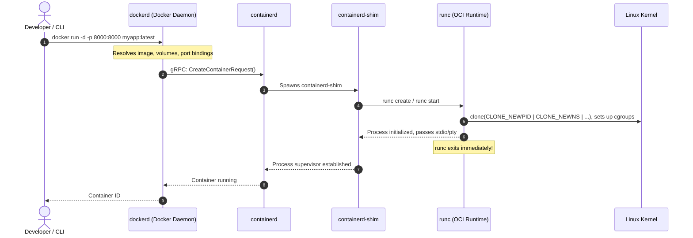

# Chapter 2: Docker Deep Dive
## Engine Architecture, Image Layering, and Container Lifecycles

*Author: Sudheer K. Mohammed*

---


### Chapter Overview
Docker transformed container technology from an arcane systems administration discipline into the foundation of modern cloud-native computing. While most tutorials reduce Docker to simple invocations like `docker run`, operating Docker reliably in production requires an engineering-level comprehension of the engine's internal components, image distribution mechanics, and the storage drivers that power the filesystem.

In this chapter, we explore:
1. The decoupled Docker Engine architecture: `docker CLI`, `dockerd`, `containerd`, `containerd-shim`, and `runc`.
2. The Open Container Initiative (OCI) image specification and content-addressable storage.
3. The mechanics of the `overlay2` Union Filesystem, Copy-on-Write (CoW), and directory merges.
4. Production Dockerfile engineering: Multi-stage builds, cache optimization, zombie process reaping, and least-privilege security.
5. A hands-on production microservice implementation with non-root security and health monitoring.

---

## 2.1 The Modern Docker Engine Architecture

Early iterations of Docker (pre-v1.11) were implemented as a monolithic daemon where image building, container execution, network bridging, and volume management were bundled into a single binary (`docker`). A crash in the daemon killed all active containers.

Modern Docker is completely modular, adhering to the **Open Container Initiative (OCI)** standards:



### 1. Docker CLI (`docker`)
A lightweight Go binary that accepts user commands and communicates with the daemon over a UNIX domain socket (`/var/run/docker.sock`) or an encrypted TLS TCP socket (`tcp://0.0.0.0:2376`) via a standard REST API.

### 2. Docker Daemon (`dockerd`)
The persistent background service responsible for:
- Routing high-level API requests.
- Managing network virtualization (bridges, overlay networks, iptables/nftables port forwarding).
- Managing Docker volumes and storage driver allocations.
- Authenticating and interfacing with container registries (Docker Hub, AWS ECR, Quay).

### 3. `containerd`
A CNCF graduated container runtime that manages the complete container lifecycle of its host system: image transfer and storage, container execution and supervision, low-level storage attachments, and network attachments. `containerd` is engine-agnostic and powers both Docker and Kubernetes (via CRI-containerd).

### 4. `containerd-shim`
A tiny daemon spawned for every running container. The shim solves two critical architectural problems:
- **Daemonless Containers:** It allows `dockerd` and `containerd` to be restarted or upgraded during maintenance without terminating running containers.
- **File Descriptor & Exit Status Persistence:** It maintains open standard I/O (stdin, stdout, stderr) pipes and captures the exit code even if the container exits while the engine is down.

### 5. `runc`
The reference implementation of the OCI runtime specification (`runtime-spec`). Written in Go and C, `runc` interacts directly with Linux kernel system calls (`clone`, `unshare`, `pivot_root`, `setns`) to configure namespaces and cgroups. Once the container process is safely initialized, `runc` terminates, leaving `containerd-shim` as the parent process.

---

## 2.2 Image Anatomy: OCI Layers and Content-Addressable Storage

A container image is not a virtual machine disk image (such as `.vmdk` or `.qcow2`). It is a tarball of tarballs accompanied by cryptographic manifests and JSON metadata.

### The OCI Image Layout
When you inspect an image or pull from an OCI registry, the payload consists of:

```
myapp_image/
├── oci-layout              # OCI layout version marker {"imageLayoutVersion": "1.0.0"}
├── index.json              # Entry point pointing to image manifests
├── blobs/sha256/
│   ├── a3ed95ca...         # Manifest JSON (describes layers and config)
│   ├── f864b241...         # Configuration JSON (architecture, env, cmd, entrypoint)
│   ├── e4c8914b...         # RootFS Layer 1 (tar.gz)
│   ├── 571249fa...         # RootFS Layer 2 (tar.gz)
│   └── d1907cb3...         # RootFS Layer 3 (tar.gz)
```

### Content-Addressable Storage (CAS)
Every layer blob in Docker is named strictly by its **SHA-256 cryptographic digest**. This immutability ensures:
- **Deduplication:** If ten different images are built upon `ubuntu:22.04`, the base OS layer is stored on disk exactly once.
- **Integrity Verification:** A corrupted layer or tampered payload is detected immediately because the computed SHA-256 will not match the requested digest.

---

## 2.3 The Overlay2 Storage Driver and Copy-on-Write (CoW)

How does Docker assemble multiple read-only layers into what appears to be a single, writable filesystem inside the running container? The answer lies in the **Overlay2 Union Filesystem**.

OverlayFS operates by stacking multiple directory trees on top of one another:

```
+-------------------------------------------------------------+
|                 MERGED VIEW (/var/run/...)                  |
|    (Unified directory seen by the running container process)|
+-------------------------------------------------------------+
                              ▲
                              │
+-----------------------------+-------------------------------+
|         UPPERDIR (Read-Write Container Layer)               |
|         Stores newly created files, edits, and deletions    |
+-------------------------------------------------------------+
                              ▲
                              │
+-----------------------------+-------------------------------+
|         LOWERDIR (Read-Only Image Layers, stacked)          |
|         Layer 3: Application code & dependencies            |
|         Layer 2: Python / C++ Runtimes                      |
|         Layer 1: Base Operating System (Ubuntu/Debian)      |
+-------------------------------------------------------------+
```

### Inspecting Overlay2 on the Host
You can inspect the live OverlayFS mount parameters of any running container using:

```bash
docker inspect <container_id> --format '{{json .GraphDriver.Data}}' | jq .
```
This outputs:
```json
{
  "LowerDir": "/var/lib/docker/overlay2/<layer-c>/diff:/var/lib/docker/overlay2/<layer-b>/diff:/var/lib/docker/overlay2/<layer-a>/diff",
  "MergedDir": "/var/lib/docker/overlay2/<layer-id>/merged",
  "UpperDir": "/var/lib/docker/overlay2/<layer-id>/diff",
  "WorkDir": "/var/lib/docker/overlay2/<layer-id>/work"
}
```

### The Mechanics of Copy-on-Write (CoW)
1. **File Reading:** When a container process opens a file for reading, the kernel searches from the `upperdir` downward through each layer in `lowerdir`. The first matching file is served.
2. **File Modification (Copy-Up):** When a container modifies an existing read-only file (e.g., editing `/etc/hosts`), the kernel intercepts the write operation, copies the entire file from the `lowerdir` up into the `upperdir`, and executes the write on the copy. The underlying image layer remains completely pristine.
3. **File Deletion (Whiteouts):** If a container deletes a file that exists in a read-only lower layer, the kernel creates a special **character device (0,0)** or sets an extended attribute (`trusted.overlay.whiteout`) in the `upperdir`. This "whiteout" masks the file from the merged view without altering the underlying image layer.

---

## 2.4 Production Dockerfile Engineering

Writing an inefficient Dockerfile results in bloated images (several gigabytes), security vulnerabilities, and excruciatingly slow CI/CD build times. Professional Docker development adheres to four core principles:

### 1. Multi-Stage Builds
Multi-stage builds allow developers to use heavy toolchains (compilers, build headers, package managers) in temporary build stages and copy only the compiled binaries and runtime artifacts into a lean final stage.

### 2. Cache Invalidation Discipline
Docker evaluates Dockerfile instructions sequentially. If a layer's inputs change, that layer and all subsequent layers must be rebuilt. Therefore:
- Place frequently changing files (e.g., application source code) as low as possible.
- Place static files and dependency installation (e.g., `package.json`, `requirements.txt`, `go.mod`) earlier.

### 3. The PID 1 Zombie Reaping Problem
In Linux, the process with PID 1 is responsible for:
- Adopting orphaned child processes.
- Reaping terminated child processes (preventing zombies in the process table).
- Forwarding system signals (`SIGTERM`, `SIGINT`) to child processes.

Standard language runtimes (like Python, Node.js, or Java) are not designed to act as init systems. If a child process forks and terminates, it remains in the process table as `<defunct>`. To resolve this, use lightweight init systems like **`tini`** or pass the `--init` flag to `docker run`.

### 4. Non-Root Execution
By default, Docker executes containers as `root` (UID 0). In production environments, an attacker who achieves Remote Code Execution (RCE) inside a container will possess root privileges. Always declare a dedicated unprivileged user (`USER appuser`) with a known UID/GID (> 10000).

---

## 2.5 Practical Project: Production Multi-Stage Python API

Below is a complete, production-hardened Dockerfile for a high-performance Python FastAPI service demonstrating multi-stage compilation, non-root user execution, signal handling via `tini`, and native health checks.

```dockerfile
# ==========================================
# STAGE 1: Builder
# ==========================================
FROM python:3.11-slim-bookworm AS builder

# Set build-time environment variables
ENV PYTHONDONTWRITEBYTECODE=1 \
    PYTHONUNBUFFERED=1 \
    PIP_NO_CACHE_DIR=1 \
    PIP_DISABLE_PIP_VERSION_CHECK=1

WORKDIR /build

# Install compiler dependencies required for C-extensions
RUN apt-get update && apt-get install -y --no-install-recommends \
    gcc \
    libpq-dev \
    build-essential \
    && rm -rf /var/lib/apt/lists/*

# Copy dependency specification first to leverage Docker layer caching
COPY requirements.txt .

# Install dependencies into a isolated virtual environment
RUN python -m venv /opt/venv
ENV PATH="/opt/venv/bin:$PATH"
RUN pip install --upgrade pip && \
    pip install -r requirements.txt

# ==========================================
# STAGE 2: Lean Production Runtime
# ==========================================
FROM python:3.11-slim-bookworm AS runtime

# Install tini for PID 1 signal forwarding and zombie reaping
RUN apt-get update && apt-get install -y --no-install-recommends \
    tini \
    curl \
    && rm -rf /var/lib/apt/lists/*

# Create dedicated non-root system group and user
RUN groupadd -g 10001 appgroup && \
    useradd -u 10001 -g appgroup -s /sbin/nologin -d /app appuser

WORKDIR /app

# Copy virtualenv from builder stage
COPY --from=builder /opt/venv /opt/venv
ENV PATH="/opt/venv/bin:$PATH"

# Copy application source code
COPY --chown=appuser:appgroup ./app /app/app

# Set runtime environment variables
ENV PORT=8000 \
    PYTHONUNBUFFERED=1

# Expose service port
EXPOSE 8000

# Health check to allow Docker and orchestrators to monitor service readiness
HEALTHCHECK --interval=30s --timeout=5s --start-period=5s --retries=3 \
  CMD curl -f http://localhost:8000/health || exit 1

# Switch to unprivileged user
USER appuser:appgroup

# Use tini as PID 1 init process
ENTRYPOINT ["/usr/bin/tini", "--"]

# Execute application with Uvicorn
CMD ["uvicorn", "app.main:app", "--host", "0.0.0.0", "--port", "8000"]
```

---

## 2.6 The Container Lifecycle & Essential CLI Toolset

```
                  +-------------------+
                  |   Dockerfile      |
                  +-------------------+
                            │ docker build
                            ▼
                  +-------------------+
                  |   Docker Image    |
                  +-------------------+
                     │             ▲
          docker run │             │ docker commit
                     ▼             │
+-----------------------------------------------+
|              CONTAINER LIFECYCLE              |
|                                               |
|  [ Created ] ──► [ Running ] ──► [ Paused ]   |
|       ▲                │               │      |
|       │                ▼               ▼      |
|  docker start    [ Stopped ] ◄── docker unpause|
|                        │                      |
|                        ▼ docker rm            |
|                   [ Destroyed ]               |
+-----------------------------------------------+
```

### Indispensable Docker Commands for Engineers

| Command | Operational Purpose |
| :--- | :--- |
| `docker build -t myapp:1.0 --target runtime .` | Builds an image up to a specific multi-stage target |
| `docker run -d --name api -p 8000:8000 --init myapp:1.0` | Runs in background with port mapping and init wrapper |
| `docker logs --tail 100 -f <container_name>` | Streams the last 100 log lines in real time |
| `docker exec -it <container_name> /bin/sh` | Drops an interactive debugging shell into a running container |
| `docker stats` | Live real-time stream of CPU, memory, network I/O, and block I/O per container |
| `docker system df` | Displays disk space consumption across images, containers, and build cache |
| `docker system prune -a --volumes` | Reclaims all unused containers, networks, dangling images, and build caches |

---

## 2.7 Summary & Key Takeaways

1. **Modular Engine:** Docker is not a monolith; it delegates lifecycle execution to `containerd` and low-level namespace/cgroup creation to `runc`.
2. **Immutable Layering:** Images are composed of read-only tarball layers addressed by SHA-256 hashes.
3. **Overlay2 Efficiency:** The Union Filesystem combines multiple read-only layers with one ephemeral read-write container layer, using Copy-on-Write for mutations.
4. **Production Hardening:** Professional Docker images must employ multi-stage builds to shed compilers, use `tini` for PID 1 signal handling, run under non-root users, and include active `HEALTHCHECK` instructions.
