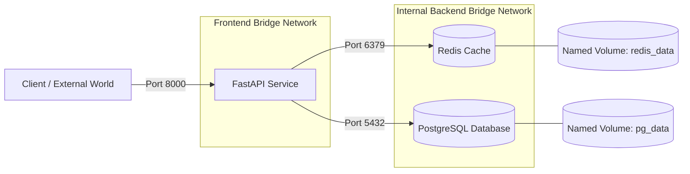

# Chapter 3: Composing Multi-Tier Architectures
## Networking, Storage Volumes, and Docker Compose

*Author: Sudheer K. Mohammed*

---


### Chapter Overview
Modern production applications rarely exist as isolated monolithic processes. Instead, they operate as distributed graphs of interacting components: stateless API servers, distributed caching layers, relational databases, asynchronous task queues, and telemetry collectors.

Orchestrating these multi-container topologies on developer workstations and edge servers requires mastering **Docker Networking**, **Storage Volumes**, and the **Docker Compose** declarative specification.

In this chapter, we dissect:
1. Docker networking mechanics: Bridge networks, embedded DNS discovery, host networking, and overlay topologies.
2. Storage strategies: Named volumes, bind mounts, and volatile `tmpfs` mounts.
3. The modern Docker Compose V2 specification: Multi-stage orchestration, environment injection, and resource fences.
4. Health-driven dependency ordering (`condition: service_healthy`).
5. A hands-on project: Building a hardened three-tier stack comprising FastAPI, Redis, and PostgreSQL with network segmentation.

---

## 3.1 Docker Networking Internals

When you launch a container, Docker isolates its network stack inside a dedicated Network Namespace (`CLONE_NEWNET`). The container receives its own loopback device, private IP address, routing table, and iptables rules.

Docker provides four primary network drivers:

```
+-----------------------------------------------------------------------------------------+
|                                    DOCKER HOST                                          |
|                                                                                         |
|   +-----------------------+      +-----------------------+      +-------------------+   |
|   |      Container A      |      |      Container B      |      |    Container C    |   |
|   |      (eth0: 172.20.0.2)      |      (eth0: 172.20.0.3)      |    (Host Network) |   |
|   +-----------┬-----------+      +-----------┬-----------+      +---------┬---------+   |
|               │ vethA                        │ vethB                      │ Direct      |
|               ▼                              ▼                            │ Access      |
|   +──────────────────────────────────────────────────────+                │             |
|   |          Custom User-Defined Bridge (br-custom)      |                │             |
|   |          - Embedded DNS: 127.0.0.11                  |                │             |
|   |          - Subnet: 172.20.0.0/16                     |                │             |
|   +───────────────────────────┬──────────────────────────+                │             |
|                               │ NAT (MASQUERADE)                          │             |
|                               ▼                                           ▼             |
|   +─────────────────────────────────────────────────────────────────────────────────+   |
|   |                         Host Network Interface (eth0 / ens3)                    |   |
|   +─────────────────────────────────────────────────────────────────────────────────+   |
+-----------------------------------------------------------------------------------------+
```

### 1. User-Defined Bridge Networks
A bridge network is a software switch running on the Linux host kernel. When you create a custom bridge network (`docker network create app-net`), Docker creates a Linux bridge interface (e.g., `br-d4c5...`). 

For each container attached to the bridge:
- Docker creates a **Virtual Ethernet pair (`veth`)**.
- One end of the pair is moved into the container's network namespace and named `eth0`.
- The other end remains in the host network namespace attached directly to the bridge switch.

#### Embedded DNS Resolution (127.0.0.11)
Crucially, **custom user-defined bridge networks provide automatic service discovery via Docker's embedded DNS server (`127.0.0.11`)**. Containers can reach one another using their container or service names (e.g., `curl http://redis_cache:6379`). The legacy default bridge (`docker0`) does **not** provide DNS discovery, requiring obsolete `--link` parameters.

### 2. Host Networking (`--network host`)
Host networking removes the network namespace isolation entirely. The container shares the host's network interfaces, IP addresses, and port namespace directly.
- **Advantages:** Maximum throughput, zero NAT/iptables translation overhead.
- **Drawbacks:** Port collisions (if two containers bind to port 8000, one fails); security risk if container is compromised. Commonly used in HPC or high-frequency trading.

### 3. Overlay Networks
Used in multi-host environments (Docker Swarm / Kubernetes). An overlay network utilizes **VXLAN (Virtual Extensible LAN)** encapsulation to create an L2 network across multiple distributed nodes over an underlying L3 IP network.

---

## 3.2 Storage Strategies: Named Volumes vs. Bind Mounts

Containers are designed to be ephemeral: when a container is destroyed, its writable `upperdir` layer is discarded. To preserve databases, state, and application logs, Docker provides persistent storage primitives:

| Feature | Named Volumes | Bind Mounts | tmpfs Mounts |
| :--- | :--- | :--- | :--- |
| **Host Location** | Managed by Docker in `/var/lib/docker/volumes/` | Arbitrary host directory (e.g., `/home/user/project`) | RAM only (never written to physical disk) |
| **Lifecycle** | Independent of container lifecycle | Independent of container lifecycle | Tied to container lifecycle; wiped on stop |
| **Portability** | High (abstracted storage across dev/prod) | Low (hardcodes host file paths) | High (standard POSIX memory) |
| **Driver Support** | Extensible (NFS, AWS EBS, Ceph, GlusterFS) | Local host filesystem only | Host RAM |
| **Best For** | Databases, production state, caches | Live code reloading in local development | Sensitive credentials, API keys, high-speed ephemeral scratch |

### Production Volume Declaration
```bash
# Create an encrypted or persistent named volume
docker volume create --name postgres_data

# Inspect volume metadata
docker volume inspect postgres_data
```

---

## 3.3 Docker Compose V2 Architecture

Docker Compose is a declarative tool for defining and running multi-container Docker applications. Since 2021, Compose has been rewritten in Go as a native Docker CLI plugin (`docker compose` instead of Python-based `docker-compose`).

### Key Compose Capabilities
1. **Single-Command Lifecycle:** `docker compose up -d` boots an entire stack in the correct dependency order.
2. **Predictable Isolation:** Automatically creates a dedicated private bridge network for the stack, isolating it from other workloads on the host.
3. **Environment Injection:** Cascades environment variables from `.env` files and host shells directly into container runtime definitions.
4. **Health-Aware Startup:** Uses `condition: service_healthy` to ensure dependent services (like web APIs) wait until backing databases are fully responsive before starting.

---

## 3.4 Hands-On Project: 3-Tier Enterprise Microservice Stack

Let us build a complete, resilient production stack comprising:
- **`fastapi_app`**: Python 3.11 web service with non-root security.
- **`redis_cache`**: High-performance in-memory caching layer.
- **`postgres_db`**: Relational database with persistent storage and initialization scripts.

### 1. Network Segmentation Architecture
We isolate database traffic from the outside world using two distinct bridge networks:
- **`frontend_net`**: Connects the outside client to the FastAPI application.
- **`backend_net`**: Internal network connecting FastAPI to PostgreSQL and Redis. The database is **unreachable** from the public internet.



### 2. The Production `docker-compose.yml`

```yaml
version: "3.9"

services:
  # ---------------------------------------------
  # 1. DATABASE SERVICE: PostgreSQL
  # ---------------------------------------------
  postgres_db:
    image: postgres:16-alpine
    container_name: production_postgres
    restart: unless-stopped
    environment:
      POSTGRES_USER: ${DB_USER:-dbadmin}
      POSTGRES_PASSWORD: ${DB_PASSWORD:-SuperSecretSecurePass123!}
      POSTGRES_DB: ${DB_NAME:-scientific_db}
    volumes:
      - postgres_data:/var/lib/postgresql/data
    networks:
      - backend_net
    deploy:
      resources:
        limits:
          cpus: "2.0"
          memory: 2048M
    healthcheck:
      test: ["CMD-SHELL", "pg_isready -U ${DB_USER:-dbadmin} -d ${DB_NAME:-scientific_db}"]
      interval: 10s
      timeout: 5s
      retries: 5
      start_period: 10s

  # ---------------------------------------------
  # 2. CACHING SERVICE: Redis
  # ---------------------------------------------
  redis_cache:
    image: redis:7.2-alpine
    container_name: production_redis
    restart: unless-stopped
    command: ["redis-server", "--appendonly", "yes", "--requirepass", "${REDIS_PASSWORD:-RedisSecurePass999!}"]
    volumes:
      - redis_data:/data
    networks:
      - backend_net
    deploy:
      resources:
        limits:
          cpus: "1.0"
          memory: 512M
    healthcheck:
      test: ["CMD", "redis-cli", "-a", "${REDIS_PASSWORD:-RedisSecurePass999!}", "ping"]
      interval: 10s
      timeout: 3s
      retries: 3
      start_period: 5s

  # ---------------------------------------------
  # 3. WEB API SERVICE: FastAPI
  # ---------------------------------------------
  fastapi_app:
    build:
      context: ./01_docker_web_api
      dockerfile: Dockerfile
    container_name: production_api
    restart: unless-stopped
    ports:
      - "8000:8000"
    environment:
      - DATABASE_URL=postgresql://${DB_USER:-dbadmin}:${DB_PASSWORD:-SuperSecretSecurePass123!}@postgres_db:5432/${DB_NAME:-scientific_db}
      - REDIS_URL=redis://:${REDIS_PASSWORD:-RedisSecurePass999!}@redis_cache:6379/0
      - ENVIRONMENT=production
    networks:
      - frontend_net
      - backend_net
    depends_on:
      postgres_db:
        condition: service_healthy
      redis_cache:
        condition: service_healthy
    deploy:
      resources:
        limits:
          cpus: "2.0"
          memory: 1024M
    healthcheck:
      test: ["CMD", "curl", "-f", "http://localhost:8000/health"]
      interval: 15s
      timeout: 5s
      retries: 3
      start_period: 10s

# ---------------------------------------------
# NETWORKS DEFINITION
# ---------------------------------------------
networks:
  frontend_net:
    driver: bridge
  backend_net:
    driver: bridge
    internal: true # Disables external outbound routing for zero-trust DB security

# ---------------------------------------------
# VOLUMES DEFINITION
# ---------------------------------------------
volumes:
  postgres_data:
    driver: local
  redis_data:
    driver: local
```

---

## 3.5 Managing Compose Stacks in Practice

Executing and observing the multi-tier application is streamlined via the Docker CLI:

```bash
# 1. Validate the syntax and render resolved environment variables
docker compose config

# 2. Build and launch all services in detached mode
docker compose up -d --build

# 3. Inspect running services and health status
docker compose ps
```
Example Output:
```
NAME                  IMAGE                COMMAND                  SERVICE        STATUS                   PORTS
production_api        web_api:latest       "/usr/bin/tini -- uv…"   fastapi_app    running (healthy)        0.0.0.0:8000->8000/tcp
production_postgres   postgres:16-alpine   "docker-entrypoint.s…"   postgres_db    running (healthy)        5432/tcp
production_redis      redis:7.2-alpine     "docker-entrypoint.s…"   redis_cache    running (healthy)        6379/tcp
```

```bash
# 4. View aggregated real-time logs across the entire stack
docker compose logs -f --tail 50

# 5. Perform rolling restart of the API tier only
docker compose restart fastapi_app

# 6. Graceful shutdown without data loss
docker compose down
```

---

## 3.6 Summary & Key Takeaways

1. **Service Discovery:** User-defined bridge networks provide automatic DNS routing (`127.0.0.11`) using service names.
2. **Zero-Trust Networks:** Setting `internal: true` on backend bridge networks prevents database containers from communicating with the public internet.
3. **Persistent State:** Databases require named volumes to decouple data from ephemeral container lifecycles.
4. **Health Dependency:** Always configure `depends_on: condition: service_healthy` to guarantee that backing databases and caches are accepting connections before API servers launch.
