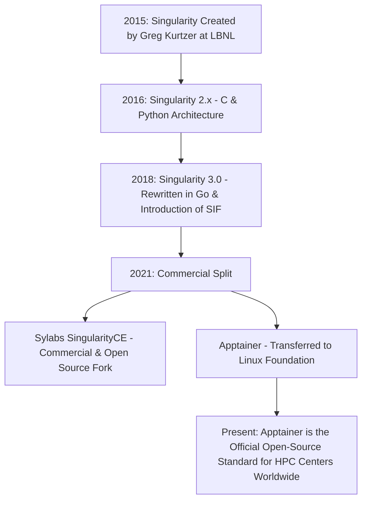

# Chapter 5: The Singularity and Apptainer Paradigm
## Origin, Architectural Philosophy, and the SIF Format

*Author: Sudheer K. Mohammed*

---


### Chapter Overview
When Singularity was introduced to the supercomputing community in 2015, it discarded the prevailing cloud container dogma: the belief that containers must strictly isolate the process from the host operating system. 

Instead, Singularity embraced a radical new architectural philosophy: **Integration over Isolation**. 

In high-performance computing, the container is not viewed as a distinct virtual machine that needs to be fenced off from the world; it is viewed as an **encapsulated executable**—a portable scientific instrument that runs directly within the user's host environment, sharing the user's identity, the host filesystem, and the cluster's high-speed accelerators.

In this chapter, we explore:
1. The historical genealogy: From Singularity 1.0 to the Linux Foundation **Apptainer** project.
2. The architectural philosophy: "Integration, Not Isolation."
3. The anatomy of the **Singularity Image Format (SIF)** binary specification.
4. Why SIF solves the parallel filesystem inode crisis on Lustre and GPFS.
5. The rootless execution model: User Namespaces, unprivileged mounts, and identity mapping.

---

## 5.1 Historical Genealogy: Singularity, SingularityCE, and Apptainer

Understanding the modern ecosystem requires untangling the relationship between Singularity and Apptainer:



- **Singularity (2015–2018):** Born at Lawrence Berkeley National Laboratory (LBNL), early versions used C wrappers and Python scripts. In 2018, Singularity 3.0 was completely rewritten in Go, replacing legacy ext3 disk images with the immutable **SIF (Singularity Image Format)**.
- **The Bifurcation (2021):** In late 2021, the open-source community moved the project to the **Linux Foundation** under the name **Apptainer** to guarantee neutral governance and prevent proprietary capture. Meanwhile, Sylabs continues to develop a commercial fork known as SingularityCE.
- **Interoperability:** For all practical engineering purposes, the CLI commands, definition files, and SIF binary files are **100% interoperable**. On modern clusters, typing `singularity` is typically a symlink to `apptainer`.

---

## 5.2 The Architectural Philosophy: Integration, Not Isolation

The contrasting philosophies of Docker and Apptainer can be summarized in a single sentence:

> **Docker assumes you want to hide the host from the container; Apptainer assumes you want to harness the host through the container.**

```
+-----------------------------------+      +-----------------------------------+
|          DOCKER MODEL             |      |         APPTAINER MODEL           |
|         (Isolation-First)         |      |       (Integration-First)         |
+-----------------------------------+      +-----------------------------------+
|  Private /home/root               |      |  Host /home/user mounted by default|
|  Private Hostname                 |      |  Host Hostname inherited          |
|  Private Network Namespace (NAT)  |      |  Host Network inherited (Direct)  |
|  Root (UID 0) by default          |      |  Host UID/GID preserved (Unpriv)  |
|  Explicit port mapping required   |      |  All host ports directly reachable|
|  Host environment variables masked|      |  Host environment variables passed|
+-----------------------------------+      +-----------------------------------+
```

### The Host User Illusion Demystified
When you execute an Apptainer container, you do **not** log into a remote system. Apptainer forks a process on the host, creates a Mount Namespace (`CLONE_NEWNS`), attaches the root filesystem inside the SIF image to `/`, and mounts your host `$HOME`, `/tmp`, and current working directory automatically.

Notice the immediate consequence:
```bash
# On the host:
$ whoami
sudheer
$ id -u
1001
$ pwd
/home/sudheer/simulation_run

# Inside Apptainer:
$ apptainer exec my_sim.sif whoami
sudheer
$ apptainer exec my_sim.sif id -u
1001
$ apptainer exec my_sim.sif pwd
/home/sudheer/simulation_run
```
Because the UID and GID inside the container are identical to the host, any file created by the container on Lustre or NFS has the correct user ownership and permissions. Root squashing errors are completely eliminated.

---

## 5.3 Deep Dive: The Singularity Image Format (SIF)

Unlike Docker, which fragments an image into dozens of separate tarball directories inside `/var/lib/docker/overlay2`, Apptainer encapsulates the entire container into **a single, monolithic binary file** ending in `.sif`.

### The Binary Layout of a SIF File
A SIF file is structured like an executable binary with a defined header table and data partitions:

```
+-------------------------------------------------------------------------------+
|                                  SIF HEADER                                   |
|   Magic Bytes ("SIF_MAGIC") | SIF Version | UUID | Timestamp | Partition Count|
+-------------------------------------------------------------------------------+
|                             PARTITION DESCRIPTORS                             |
|   Descriptor 1: Type = FS (SquashFS) | Offset = 4096   | Length = 1.8 GB      |
|   Descriptor 2: Type = Metadata      | Offset = ...    | Length = 12 KB       |
|   Descriptor 3: Type = Signature     | Offset = ...    | Length = 512 Bytes   |
|   Descriptor 4: Type = Definition    | Offset = ...    | Length = 4 KB        |
+-------------------------------------------------------------------------------+
|                            DATA PARTITION PAYLOADS                            |
|                                                                               |
|   +-----------------------------------------------------------------------+   |
|   |         SquashFS System Partition (Compressed Read-Only RootFS)       |   |
|   |         - Contains /bin, /usr, /lib, scientific software, CUDA libs   |   |
|   +-----------------------------------------------------------------------+   |
|                                                                               |
|   +-----------------------------------------------------------------------+   |
|   |         JSON Metadata & Architecture Specs                            |   |
|   +-----------------------------------------------------------------------+   |
|                                                                               |
|   +-----------------------------------------------------------------------+   |
|   |         Cryptographic Digital Signatures (PGP Keys / X.509)           |   |
|   +-----------------------------------------------------------------------+   |
|                                                                               |
|   +-----------------------------------------------------------------------+   |
|   |         Original Definition Recipe File (.def text)                   |   |
|   +-----------------------------------------------------------------------+   |
+-------------------------------------------------------------------------------+
```

### Inspecting SIF Partitions in User Space
Apptainer includes built-in tools to inspect the internal structure of any SIF file:

```bash
# List all descriptors inside a SIF container
$ apptainer sif list scientific_ai.sif

Container id: 7e34b998-32a1-4221-a589-980e123fc411
Created on:   2026-10-25 14:20:00 UTC
Modified on:  2026-10-25 14:20:00 UTC
-----------------------------------------------------------------------
ID   |GROUP   |LINK    |TYPE                 |FLAGS    |DESCR
-----------------------------------------------------------------------
1    |1       |NONE    |FS (Squashfs)        |NONE     |Root filesystem
2    |NONE    |NONE    |Metadata (JSON)      |NONE     |Image properties
3    |NONE    |NONE    |Definition (.def)    |NONE     |Apptainer recipe
4    |NONE    |1       |Signature (PGP)      |NONE     |Digital verification key
```

You can even extract the original recipe file used to build the container years after the fact:
```bash
# Extract and view the recipe that created this SIF
$ apptainer inspect --deffile scientific_ai.sif
```
This guarantees **absolute scientific reproducibility**: the experiment binary carries its own genetic blueprint.

---

## 5.4 Why SIF Rescues Parallel Filesystems (Lustre / GPFS)

To appreciate why SIF is essential on supercomputers, one must understand the **Metadata Inode Crisis**.

In an enterprise cloud, each server hosts at most a few dozen containers. In an HPC cluster:
- A user submits a SLURM job spanning **1,000 compute nodes**.
- Each node executes **64 MPI ranks**, totaling **64,000 concurrent processes**.

### The Docker Failure Mode on Lustre
If 64,000 processes simultaneously launch an uncompressed Docker image containing 150,000 files (e.g., Python `site-packages` with TensorFlow, PyTorch, SciPy):
$$64,000 \times 150,000 = 9,600,000,000 \text{ metadata requests!}$$
Nearly **10 billion filesystem lookup operations** flood the Lustre Metadata Target (MDT) simultaneously. The shared filesystem locks up, timing out jobs across the entire supercomputing center.

### The SIF Solution
With Apptainer:
1. The container is a **single 2 GB file** (`app.sif`) sitting on Lustre.
2. The Lustre MDT handles exactly **one file lookup per node** (1,000 requests instead of 10 billion).
3. The Linux kernel mounts the internal SquashFS partition using a loop device.
4. SquashFS provides high-density in-memory caching and compression (zstd), delivering **blistering I/O performance** while keeping the parallel filesystem completely stable.

---

## 5.5 The Rootless Execution Model: How Apptainer Works Without Sudo

How does an ordinary user mount a SquashFS filesystem without root privileges?

Apptainer supports two distinct backend modes depending on cluster kernel configurations:

```mermaid
flowchart TD
    Launch[User invokes: apptainer run image.sif] --> Check{User Namespaces enabled in kernel?}

    Check -- YES (Default on modern Linux) --> Unpriv[Unprivileged User Namespace Mode]
    Unpriv --> NewUser[kernel: unshare CLONE_NEWUSER | CLONE_NEWNS]
    NewUser --> FuseSquash[kernel: fuse-overlayfs or native unprivileged squashfs]
    NewUser --> Exec[Executes container as UID 1001]

    Check -- NO (Legacy Enterprise Linux 7/8) --> SUID[setuid root helper binary: starter-suid]
    SUID --> Verify[Verify user identity & security config]
    SUID --> MountFS[Mounts SquashFS loopback to /]
    SUID --> DropPriv[Permanently drops root privileges!]
    DropPriv --> Exec
```

### 1. Unprivileged User Namespaces Mode (Modern Standard)
In modern Linux kernels (RHEL 8/9, Ubuntu 20.04+, Debian 11+), unprivileged users are permitted to create user and mount namespaces. Apptainer leverages `unshare(CLONE_NEWUSER | CLONE_NEWNS)` to construct the container filesystem tree purely in user space. **No setuid binaries and no daemons are required.**

### 2. Setuid Root Helper (`starter-suid`)
On older legacy enterprise systems where unprivileged user namespaces are disabled for security hardening, Apptainer provides an audited, minimal C binary (`starter-suid`). The helper:
1. Performs the mount operation.
2. Sets up the namespace sandbox.
3. **Permanently and irreversibly drops all root capabilities** before executing the user's payload.
When the user's code executes, it has only the permissions of the invoking user.

---

## 5.6 Summary & Key Takeaways

1. **Integration-First Philosophy:** Apptainer preserves host identity, environment, and filesystems by default, seamlessly connecting the user's environment to the containerized software.
2. **The SIF Artifact:** Encapsulates the complete container filesystem, metadata, and cryptographic signatures into a single, immutable, compressed file.
3. **Filesystem Salvation:** Consolidating millions of files into one SIF prevents parallel filesystem (Lustre/GPFS) metadata server collapse.
4. **Daemonless Security:** Runs purely as a child process of the invoking shell or SLURM job without background services or privilege escalation vulnerabilities.
