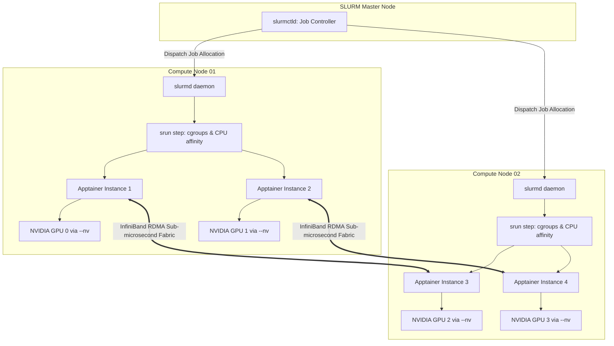

# Chapter 8: HPC Workload Orchestration
## SLURM Integration, Multi-Node MPI, and Native GPU Acceleration

*Author: Sudheer K. Mohammed*

---


### Chapter Overview
Running a container on a single workstation or cloud server is straightforward. The true litmus test of scientific containerization occurs when a workload must scale across **hundreds of compute nodes**, orchestrate **thousands of parallel CPU cores**, communicate over **InfiniBand low-latency fabrics**, and saturate **hundreds of NVIDIA or AMD GPUs**.

In this chapter, we master:
1. Orchestrating Apptainer containers within the **SLURM Workload Manager**.
2. The **Hybrid MPI Architecture**: Bridging host high-speed MPI fabrics with containerized application binaries.
3. The OpenMPI and MPICH Application Binary Interface (ABI) compatibility rules.
4. Seamless GPU hardware acceleration: The `--nv` (NVIDIA CUDA) and `--rocm` (AMD ROCm) flags.
5. InfiniBand and Remote Direct Memory Access (RDMA) passthrough.
6. A production, multi-node, multi-GPU SLURM batch submission pipeline.

---

## 8.1 SLURM Integration: The Native Process Model

Unlike Docker, which isolates processes behind a background daemon and separate network namespaces, Apptainer operates as a **direct child process** of the invoking shell or workload manager.

Because of this direct relationship:
- SLURM views `apptainer` exactly like any other compiled binary (`./a.out` or `python`).
- SLURM's Linux cgroups automatically track CPU time, memory consumption, and I/O rates of the containerized process.
- Job accounting metrics (`sacct`) reflect actual container consumption accurately.
- When a job is canceled via `scancel <job_id>`, SLURM terminates the containerized processes cleanly without leaving orphaned daemons.



---

## 8.2 The Multi-Node MPI Paradigm: The Hybrid Model

The Message Passing Interface (MPI) is the ubiquitous standard for distributed-memory parallel computing. When running MPI applications inside containers across multiple supercomputer nodes, two architectural models exist:

### 1. The Isolated Model (Container-Managed MPI)
In this model, the MPI daemon (`mpirun`) runs inside the container and attempts to connect between nodes using SSH. 
- **Why it fails in HPC:** Compute nodes rarely have open SSH ports between nodes. Furthermore, the internal MPI cannot see the host InfiniBand drivers, forcing communication to fall back to slow TCP/IP ethernet, degrading performance by 95%.

### 2. The Hybrid Model (Host-Orchestrated MPI)
In the **Hybrid Model**, the host cluster's native MPI launcher (`srun` or `mpirun`) manages process initialization, wireup, and InfiniBand fabric communication. The container contains only the compiled application binary and compatible MPI runtime libraries.

```
+-----------------------------------------------------------------------------------+
|                        COMPUTE NODE 1             COMPUTE NODE 2                  |
+-----------------------------------------------------------------------------------+
| Host SLURM Launcher:    srun ──────────────────────► srun                         |
| Host MPI Runtime:       libmpi.so (Host)             libmpi.so (Host)             |
|                               │                            │                      |
| Wireup / Handshake:           ▼                            ▼                      |
| Container Boundary:     +───────────────+            +───────────────+            |
|                         | Apptainer SIF |            | Apptainer SIF |            |
| Container MPI Lib:      | libmpi.so     |            | libmpi.so     |            |
| Container Application:  | ./mpi_solver  |            | ./mpi_solver  |            |
|                         +───────┬───────+            +───────┬───────+            |
|                                 │                            │                    |
| Fast Data Path (RDMA):          ▼                            ▼                    |
| Hardware Interconnect:  Mellanox EDR/NDR ◄══════════════════► Mellanox EDR/NDR    |
|                         InfiniBand HCA               InfiniBand HCA               |
+-----------------------------------------------------------------------------------+
```

### The Rules of MPI Compatibility
For the Hybrid Model to work, the MPI implementation inside the container must be **wire-compatible and ABI-compatible** with the host MPI:

1. **MPICH Family Compatibility:**
   - Implementations derived from MPICH (Intel MPI, MVAPICH2, Cray MPICH) share ABI compatibility. If the host uses Intel MPI, an MPICH-built container will typically run seamlessly.
2. **OpenMPI Family Compatibility:**
   - OpenMPI requires version matching. If the host runs OpenMPI 4.1.x, the container must be built with OpenMPI 4.1.x. The major and minor version numbers must align.

---

## 8.3 Hardware Acceleration: Native GPU Passthrough

One of Apptainer's most powerful innovations is zero-overhead, driver-agnostic hardware acceleration.

In Docker, utilizing an NVIDIA GPU historically required installing `nvidia-docker2`, altering `/etc/docker/daemon.json`, and passing complex runtime arguments (`--gpus all`).

In Apptainer, GPU passthrough requires a single flag: **`--nv`**.

### How `--nv` Works Under the Hood
When you pass `--nv`:
1. Apptainer inspects the host system for active NVIDIA kernel modules (`nvidia.ko`, `nvidia-uvm.ko`).
2. It queries `ldconfig` to discover the exact host driver libraries (e.g., `libcuda.so.535.104`, `libnvidia-ml.so`, `libcudnn.so`).
3. It dynamically bind-mounts these host shared libraries and device files (`/dev/nvidia*`, `/dev/nvidia-uvm`) into the container's `/usr/lib64` and `/dev` hierarchy.
4. **Result:** The containerized software talks directly to the physical GPU at bare-metal speeds. You **never** need to install NVIDIA kernel drivers inside the container!

```bash
# Verify NVIDIA GPU availability inside any container instantly:
$ apptainer exec --nv docker://ubuntu:22.04 nvidia-smi
```

### AMD ROCm Acceleration (`--rocm`)
For clusters powered by AMD Instinct accelerators (MI250X, MI300A/X), Apptainer provides the **`--rocm`** flag. It automatically detects and binds the AMD Kernel Fusion Driver (`/dev/kfd`), DRI graphics nodes (`/dev/dri/`), and ROCm user-space libraries.

```bash
# Verify AMD GPU availability:
$ apptainer exec --rocm docker://rocm/rocm-terminal rocm-smi
```

---

## 8.4 InfiniBand and High-Speed Interconnects

To achieve microsecond latency across nodes, Apptainer automatically mounts host InfiniBand hardware devices:
- Device files: `/dev/infiniband/uverbs0`, `/dev/infiniband/rdma_cm`
- Userspace verb libraries: `/etc/libibverbs.d/`

Because Apptainer shares the host network namespace by default, containerized MPI tasks communicate across InfiniBand using native **Remote Direct Memory Access (RDMA)** with zero kernel network translation.

---

## 8.5 Production Multi-Node SLURM Batch Script

Below is a complete, production-grade SLURM batch submission script (`submit_multinode_mpi.sbatch`). It allocates **4 compute nodes**, **16 NVIDIA GPUs**, and **16 MPI ranks**, executing an Apptainer container over InfiniBand.

```bash
#!/bin/bash
# ==============================================================================
# SLURM PRODUCTION BATCH SCRIPT: MULTI-NODE GPU + MPI WITH APPTAINER
# Author: Sudheer K. Mohammed
# ==============================================================================
#SBATCH --job-name=apptainer_mpi_gpu
#SBATCH --output=logs/%x_%j.out
#SBATCH --error=logs/%x_%j.err
#SBATCH --partition=gpu-cluster
#SBATCH --nodes=4                   # Total compute nodes
#SBATCH --ntasks-per-node=4         # 4 MPI ranks per node (1 per GPU)
#SBATCH --cpus-per-task=8           # 8 CPU cores per MPI rank (for data loading)
#SBATCH --gpus-per-node=4           # 4 NVIDIA H100 GPUs per node
#SBATCH --time=04:00:00             # Walltime limit (HH:MM:SS)
#SBATCH --exclusive                 # Exclusive node access for zero jitter

# ------------------------------------------------------------------------------
# 1. Environment & Module Initialization
# ------------------------------------------------------------------------------
module purge
module load slurm
module load openmpi/4.1.5
module load cuda/12.3

# Set OpenMPI fabric parameters for Mellanox InfiniBand (UCX)
export UCX_TLS=rc,sm,cuda_copy,cuda_ipc
export UCX_NET_DEVICES=mlx5_0:1
export OMPI_MCA_pml=ucx
export OMPI_MCA_btl=^openib

# Ensure standard bind paths for scratch and project storage
export APPTAINER_BINDPATH="/scratch,/projects,/local_scratch"

# Define path to immutable SIF container image
CONTAINER_SIF="/projects/research_lab/containers/scientific_sim_v2.sif"

# Create log directory
mkdir -p logs

echo "=========================================================================="
echo "Job ID:           $SLURM_JOB_ID"
echo "Allocated Nodes:  $SLURM_JOB_NODELIST"
echo "Total MPI Tasks:  $SLURM_NTASKS"
echo "Container Image:  $CONTAINER_SIF"
echo "Start Time:       $(date)"
echo "=========================================================================="

# ------------------------------------------------------------------------------
# 2. Multi-Node Execution via SLURM srun
# ------------------------------------------------------------------------------
# We invoke srun on the host. srun initializes 16 processes across the 4 nodes.
# Each process calls 'apptainer exec' with --nv (GPU) and host InfiniBand!

srun --mpi=pmix \
     apptainer exec \
     --nv \
     --bind /scratch:/scratch \
     "$CONTAINER_SIF" \
     /usr/local/bin/distributed_solver \
     --input /scratch/datasets/fluid_dynamics_3d.h5 \
     --output /scratch/results/output_run_${SLURM_JOB_ID}.h5

EXIT_CODE=$?

echo "=========================================================================="
echo "Execution finished at: $(date) with exit code: $EXIT_CODE"
echo "=========================================================================="

exit $EXIT_CODE
```

---

## 8.6 Summary & Key Takeaways

1. **Direct Process Hierarchy:** Apptainer runs directly inside the host process tree, granting SLURM native control over cgroups, resource tracking, and process cleanup.
2. **The Hybrid MPI Model:** Run host `srun` on the outside; run containerized binaries on the inside. Match MPI major/minor versions to ensure ABI compatibility.
3. **Frictionless GPU Acceleration:** The `--nv` and `--rocm` flags dynamically bind host drivers and device nodes without polluting the container image with kernel modules.
4. **InfiniBand RDMA:** Shared host network namespaces provide sub-microsecond latency across compute nodes without virtual bridge overhead.
