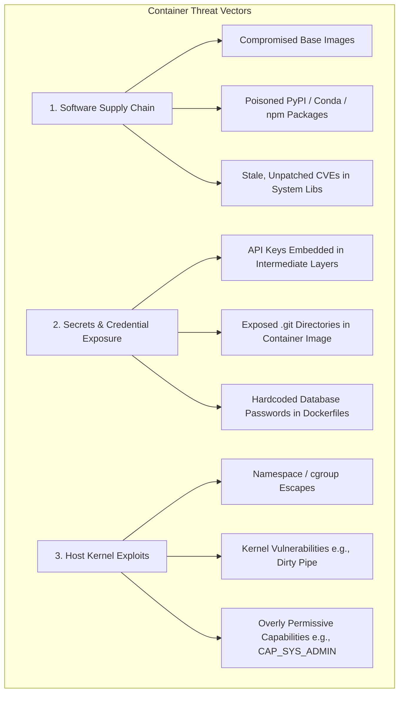

# Chapter 10: Security Audits, Compliance, and Hardening
## Enterprise Hardening, Cryptographic Verification, and Future Frontiers

*Author: Sudheer K. Mohammed*

---


### Chapter Overview
Containers package an application's entire software supply chain—operating system libraries, runtime binaries, language modules, and third-party dependencies—into an executable bundle. While this delivers unmatched portability and reproducibility, it also transfers the burden of security auditing, vulnerability mitigation, and compliance directly onto the container author.

An uninspected container running outdated OpenSSL libraries, vulnerable glibc binaries, or malicious third-party Python packages represents a severe liability to both enterprise clouds and shared supercomputing centers.

In this chapter, we master:
1. Threat vectors: Supply chain attacks, kernel privilege escalation, and secrets leakage.
2. Automated vulnerability scanning and Software Bill of Materials (SBOM) generation using **Trivy**, **Grype**, and **Syft**.
3. Cryptographic provenance: Signing and verifying containers using **Cosign (Sigstore)** for Docker and **PGP / X.509** for Apptainer SIF.
4. Cluster-wide execution policies and cryptographic verification in `apptainer.conf`.
5. The 10-point production hardening checklist.
6. Future frontiers: Confidential Computing (AMD SEV-SNP, Intel TDX) and the convergence of Kubernetes and HPC.

---

## 10.1 The Container Threat Landscape

To harden containerized workloads, security engineers must understand the three primary attack vectors:



### 1. Software Supply Chain Attacks
Attackers frequently publish typosquatted packages on PyPI, npm, or Docker Hub (e.g., `reqeusts` instead of `requests`) containing reverse shells or cryptocurrency miners. If a Dockerfile or Apptainer recipe pulls these packages, the compromise is baked into the immutable image.

### 2. Leaked Secrets in Image Layers
A common developer anti-pattern is downloading secrets during an intermediate build step and deleting them in a later step:
```dockerfile
# FATAL FLAW: Even if deleted in layer 2, the secret remains forever in layer 1!
RUN curl -o /etc/credentials.json https://internal.corp/secret.json
RUN rm /etc/credentials.json
```
Anyone with access to the Docker image can use `docker history` or inspect the underlying tarball blob to extract the deleted credentials.
- **Fix:** Always use Docker BuildKit secret mounts (`RUN --mount=type=secret,id=mysecret ...`) or inject secrets strictly at runtime via environment variables or Kubernetes/SLURM secret vaults.

---

## 10.2 Vulnerability Scanning and Software Bill of Materials (SBOM)

Enterprise and government compliance (such as NIST SP 800-190 and FedRAMP) mandates that all container images pass automated Common Vulnerabilities and Exposures (CVE) scanning and provide a machine-readable **Software Bill of Materials (SBOM)** before deployment.

### 1. Generating an SBOM with Syft
**Syft** analyzes container images (both Docker and Apptainer SIF) and catalogs every installed package, language library, and dependency:

```bash
# Generate a standardized SPDX or CycloneDX SBOM for an Apptainer SIF image
$ syft packages scientific_app.sif -o cyclonedx-json > sbom.json
```

### 2. Vulnerability Scanning with Trivy and Grype
**Trivy** and **Grype** cross-reference an image or its SBOM against the National Vulnerability Database (NVD) and distribution security advisories:

```bash
# Scan a Docker image for Critical and High vulnerabilities, failing the CI build if found
$ trivy image --severity HIGH,CRITICAL --exit-code 1 myorg/api:latest

# Scan an Apptainer SIF image directly with Grype
$ grype scientific_app.sif
```
Example Output:
```
NAME          INSTALLED      FIXED-IN      TYPE          VULNERABILITY   SEVERITY
openssl       3.0.2-0ubuntu  3.0.2-0ubuntu1 deb           CVE-2023-0286   High
curl          7.81.0-1ubunt  7.81.0-1ubunt2 deb           CVE-2023-38545  Critical
torch         2.0.1                        python        GHSA-47fc-vmwq  Medium
```

---

## 10.3 Cryptographic Signing and Provenance Verification

How do cluster administrators guarantee that a container running on a $50M supercomputer was actually built by an authorized research team and has not been altered or tampered with?

### 1. Signing OCI / Docker Images with Cosign (Sigstore)
Cosign allows developers to sign container images stored in OCI registries using cryptographic key pairs or keyless OIDC identity:

```bash
# Generate a cryptographic key pair
$ cosign generate-key-pair

# Sign the Docker image digest
$ cosign sign --key cosign.key ghcr.io/my-org/simulation-core:v1.0.0

# Verify image authenticity prior to deployment
$ cosign verify --key cosign.pub ghcr.io/my-org/simulation-core:v1.0.0
```

### 2. Cryptographic SIF Signing in Apptainer
Apptainer has native, built-in support for digital signatures using PGP keys:

```bash
# Step 1: Generate an unprivileged PGP key pair
$ apptainer key newpair
Enter your name: Sudheer K. Mohammed
Enter your email: sudheer@hpc-research.org
Enter key comment: Production HPC Verification Key
Enter passphrase: ************************

# Step 2: Sign the immutable SIF file
$ apptainer sign scientific_app.sif
Signing image with key: 0x9B4E12F8...
Signature successfully created!

# Step 3: Verify the integrity and authenticity of the SIF
$ apptainer verify scientific_app.sif
Container is signed by:
  Key Fingerprint: 4F9B 812A C3D4 E5F6 7890 1234 5678 9ABC DEF0 1234
  Signer Name:     Sudheer K. Mohammed <sudheer@hpc-research.org>
  Status:          [VERIFIED] Integrity intact; image has not been tampered with.
```

### 3. Enforcing Execution Policies in `apptainer.conf`
HPC administrators can configure `/etc/apptainer/apptainer.conf` or execution control lists (`ecl.toml`) to enforce that **only containers signed by trusted public keys can execute on the cluster**:

```toml
# /etc/apptainer/ecl.toml
activated = true

[[validate]]
  name = "Authorized Institutional Keys"
  fingerprints = [
    "4F9B812AC3D4E5F67890123456789ABCDEF01234" # Sudheer K. Mohammed Public Key
  ]
```
If an unverified or modified SIF file is submitted to SLURM, Apptainer rejects execution with:
`FATAL: image verification failed: image is not signed by any authorized keys.`

---

## 10.4 The 10-Point Production Hardening Checklist

Prior to approving any container for enterprise production or multi-tenant supercomputing clusters, verify compliance against this checklist:

| # | Security Control | Docker Implementation | Apptainer / Singularity Implementation |
| :---: | :--- | :--- | :--- |
| **1** | **Unprivileged Identity** | `USER 10001:10001` declared in Dockerfile | Automatic (Forces host unprivileged UID/GID) |
| **2** | **Read-Only Root Filesystem** | `docker run --read-only ...` | Native SIF format is inherently read-only SquashFS |
| **3** | **Drop Dangerous Capabilities** | `--cap-drop=ALL` | Dropped automatically by runtime engine |
| **4** | **Prevent Privilege Escalation** | `--security-opt no-new-privileges:true` | Enforced by default in user namespace mode |
| **5** | **Zero Secrets in Image Layers** | BuildKit secret mounts (`--mount=type=secret`) | Never put tokens in `%files` or `%post` |
| **6** | **Automated CVE Scanning** | Trivy / Grype in CI pipeline | Syft + Grype automated audit |
| **7** | **Cryptographic Provenance** | Cosign / Notary image signature | `apptainer sign` with PGP / X.509 keys |
| **8** | **Minimal Base Images** | Alpine, Distroless, or Debian-Slim | Minimal OS bootstrap; multi-stage strip |
| **9** | **Resource Ceilings** | cgroups CPU & Memory limits in Compose | Governed natively by SLURM cgroup fences |
| **10**| **Explicit Signal Forwarding** | `tini` or `dumb-init` as PID 1 | Shell `exec` wrapper in `%runscript` |

---

## 10.5 Future Frontiers in Scientific Containerization

As we look toward the next decade of distributed systems and exascale computing, three technological revolutions are reshaping containerization:

### 1. Confidential Containers (CoCo)
In healthcare, genomics, and financial research, data privacy regulations (HIPAA, GDPR) prohibit analyzing unencrypted patient genomes on shared third-party cloud supercomputers. **Confidential Computing** utilizes hardware-enforced memory encryption—such as **AMD SEV-SNP (Secure Encrypted Virtualization)** and **Intel TDX (Trust Domain Extensions)**. 
- Emerging confidential container runtimes run SIF images inside encrypted hardware enclaves. Even a rogue root administrator on the physical cluster cannot inspect the memory or decryption keys of the running container.

### 2. WebAssembly (Wasm / WASI) in High-Performance Computing
WebAssembly is transcending the web browser. With WASI (WebAssembly System Interface), compiled C++, Rust, and Fortran binaries run in ultra-lightweight, memory-safe sandboxes that instantiate in **sub-milliseconds** (< 1 ms). In serverless scientific pipelines, Wasm runtimes (Wasmtime, WasmEdge) are emerging as an ultra-fast complement to traditional container runtimes.

### 3. The Convergence of Kubernetes and HPC
Historically divided, cloud-native Kubernetes and supercomputing SLURM are converging:
- **Cloud-Native Supercomputing:** Projects like `MPI-Operator`, `Kueue` (job queueing controller for K8s), and `vcluster` allow research facilities to run massive multi-node GPU jobs natively on Kubernetes clusters.
- Simultaneously, projects like **Apptainer-CRI** allow Kubernetes worker nodes to execute Apptainer SIF containers directly, uniting cloud orchestration with HPC filesystem performance.

---

## 10.6 Summary & Key Takeaways

1. **Shift Left on Security:** Scan early and often using Trivy, Grype, and Syft. Catching CVEs in CI prevents compromised code from entering the cluster.
2. **Never Bake Secrets:** Use ephemeral runtime injection or build-time secret mounts. Intermediate layer deletion leaves secrets permanently exposed.
3. **Cryptographic Trust:** Sign images with Cosign (Docker) or PGP (Apptainer). Enforce execution policies so only verified containers run on production hardware.
4. **The Horizon:** Confidential computing enclaves, WebAssembly modules, and Kubernetes-HPC convergence represent the future of scientific and enterprise containerization.
